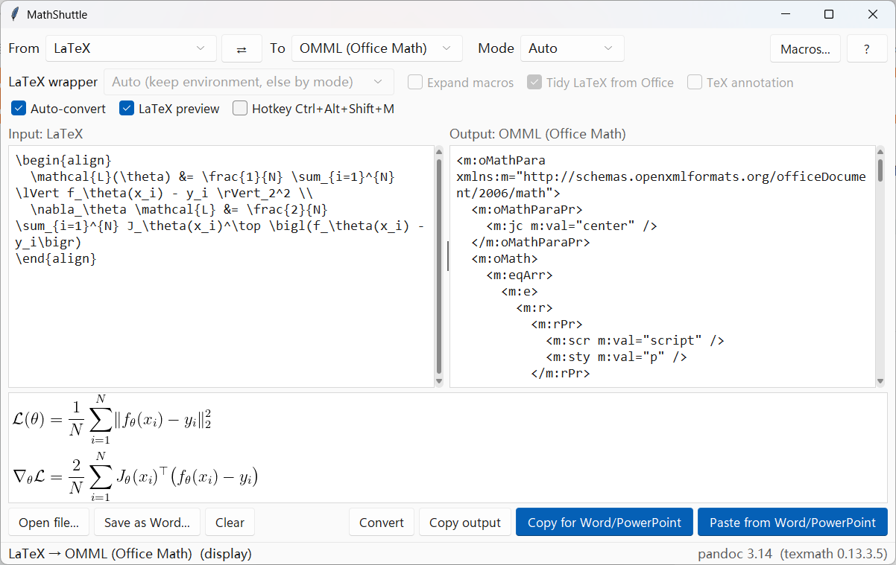

# MathShuttle

Move equations between LaTeX and Word / PowerPoint, both ways, offline.

* **LaTeX to Word and PowerPoint.** Copy LaTeX, with your paper's macros, and paste it into Word or
  PowerPoint as a native, editable equation. Aligned blocks arrive lined up at the `=` signs.
* **Word and PowerPoint to LaTeX.** Copy an equation in Office and get LaTeX you can put in a paper
  (`\mathrm{OOD}`, `\operatorname{softmax}`, `\boldsymbol{\theta}`, `cases`, `a &= b`). An equation you
  sent and nobody edited comes back as the LaTeX you wrote.
* **Whole papers to Word, and back.** A `.tex` or Markdown file, or a pasted chat answer, becomes a Word
  document with native equations, numbered as LaTeX numbers them, with references and citations. When a
  co-author sends it back edited, MathShuttle lists the equations they changed, deleted, added or
  commented, and writes a corrected copy of your `.tex`.
* **Every equation of a file.** List, filter and export the equations of a `.docx`, `.pptx`, `.tex` or
  `.md` file, including the LaTeX inside IguanaTeX and TeXPoint pictures on slides.
* **Other people's LaTeX.** A paper's own definitions, commands of common packages (physics, braket,
  siunitx...) and old TeX font switches are handled. An equation that still fails says why, in plain words.
* **Also:** LaTeX, MathML and OMML conversion with Typst and eqn output (a local stand-in for the
  [texmath web demo](https://johnmacfarlane.net/texmath.html)), LaTeX with your macros written out, a
  hotkey that works in any program, a LaTeX preview, and a command line.

Windows and macOS. Everything runs on your computer; nothing is sent anywhere.

## Install

1. Download the zip for your system from the
   [latest release](https://github.com/infinitr0us/MathShuttle/releases/latest):
   `MathShuttle-<version>-windows-x64.zip` or `MathShuttle-<version>-macos-arm64.zip`.
2. **Windows:** unzip it anywhere and run `MathShuttle\MathShuttle.exe`. The exe is not code-signed, so
   SmartScreen may warn the first time: *More info*, then *Run anyway*.
   **macOS:** drag `MathShuttle.app` into Applications. It is not signed by a registered developer, so
   the first time open it with System Settings > Privacy & Security > *Open Anyway*.
3. MathShuttle needs [pandoc](https://pandoc.org), the conversion engine. If pandoc is not installed,
   the window offers to download it (pandoc's own release, about 40 MB, checked against its SHA-256). You can
   also install it yourself: `winget install JohnMacFarlane.Pandoc` (Windows) or `brew install pandoc`
   (macOS).

With Python 3.9 or later (with tkinter): `pipx install mathshuttle` (or, straight from GitHub,
`pipx install git+https://github.com/infinitr0us/MathShuttle`) gives the commands `mathshuttle` (the
window without arguments, the command line with them) and `mathshuttle-gui`. No other Python packages
are needed. A LaTeX installation (MiKTeX, TeX Live, MacTeX) turns on the LaTeX preview.

## Use

1. Type or paste LaTeX, click **Copy for Word/PowerPoint** (Ctrl+Shift+C), and press Ctrl+V in Word or
   PowerPoint.
2. The other way: select an equation in Word or PowerPoint, press Ctrl+C, and click
   **Paste from Word/PowerPoint** (Ctrl+Shift+V).
3. Your macros: **Macros...** takes your paper's macro file or preamble, once.
4. A whole paper: **Open file...**, then **Whole file as Word...**, or `mathshuttle word paper.tex -o paper.docx`.

On the Mac, Cmd takes the place of Ctrl. The window follows the system's light or dark mode. On
Windows and Linux you can fix one: set `"theme"` to `"light"`, `"dark"` or `"native"` (Tk's own look) in
`settings.json` (`%APPDATA%\MathShuttle` on Windows); on the Mac the window keeps the system's look.

### Next to Office's own LaTeX support

Microsoft 365 (Version 2606 and later) turns LaTeX pasted with `$…$` / `\[…\]` delimiters into an
equation itself. It rejects `\newcommand` and `\DeclareMathOperator`, though, and gives back LaTeX in
its own style. On a 784-equation PhD thesis (Word 16.0.20527), Word's own paste turned 781 into
equations; MathShuttle converts all 784, and 764 of them come back from Word as the same symbols and
fonts. MathShuttle also works with Office versions without LaTeX paste (Office 2021 / 2024 LTSC, older
Mac Office).

## Documentation

* [Word and PowerPoint](https://github.com/infinitr0us/MathShuttle/blob/main/docs/word-and-powerpoint.md):
  both directions, what Word changes, your own LaTeX back, the preview, the hotkey
* [Documents](https://github.com/infinitr0us/MathShuttle/blob/main/docs/documents.md): Open file, Word
  export of passages and papers, equation numbers, references and citations
* [LaTeX input and output](https://github.com/infinitr0us/MathShuttle/blob/main/docs/latex-input.md):
  modes, chat answers and Markdown, macros, packs, what is rewritten for texmath, the wrapper box
* [Command line](https://github.com/infinitr0us/MathShuttle/blob/main/docs/command-line.md)
* [macOS](https://github.com/infinitr0us/MathShuttle/blob/main/docs/macos.md)
* [Building, testing and how it works](https://github.com/infinitr0us/MathShuttle/blob/main/docs/development.md)
* [Changelog](https://github.com/infinitr0us/MathShuttle/blob/main/CHANGELOG.md)

Found a problem? [Open an issue](https://github.com/infinitr0us/MathShuttle/issues/new/choose); Help >
*Copy details for a bug report* in the window copies the versions it asks for.

## How it works

The conversion engine is texmath, which runs inside pandoc (same author). MathShuttle prepares the LaTeX
that texmath cannot read (macros, packages, old syntax), tidies the LaTeX that comes back from Office,
and talks to the Word and PowerPoint clipboard. It needs only Python's standard library and pandoc.

## Licence

MIT, see [LICENSE](LICENSE). pandoc (which contains texmath) is a separate program under the GPL
(version 2 or later); MathShuttle only runs it. A copy downloaded by the window is pandoc's own release,
with its licence files next to it. A build made with `build_exe.ps1 -BundlePandoc` contains `pandoc.exe`:
if you pass such a build on, the GPL applies to that copy of pandoc (include its licence and offer its
source code).
